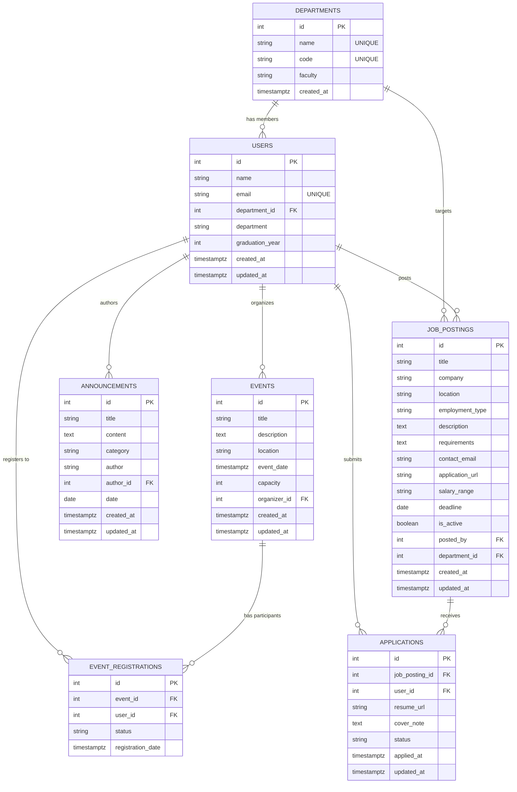

# 📊 Alumni Tracking System - Veri Tasarım Dokümanı (Data Design Documentation - DDD)

Bu doküman, **Alumni Tracking System** projesinin ilişkisel veri tabanı şemasının (PostgreSQL) ilk mimari taslağını sunmaktadır.

---

## 1. 🎯 Dokümanın Amacı ve Statüsü

- **Amaç:** Mevcut durumda bellek üzerinde (in-memory) bağımsız olarak çalışan veri yapılarını (`userModel.js`, `announcementModel.js`), gerçek dünya ilişkisel veritabanı (RDBMS - PostgreSQL) standartlarına uyumlu hale getirmek, veri bütünlüğünü garanti altına almak ve gelecekteki veritabanı entegrasyonu için rehber oluşturmaktır.
- **Statü:** **İlk Taslak (Draft v0.1)**. Sistemin tüm bileşenlerini kapsama iddiasında değildir; temel varlıkları ve bu varlıklar arasındaki ilişkileri detaylı ve tutarlı biçimde ortaya koymayı amaçlar.

---

## 2. 🔍 Kapsam (Scope)

Mevcut projede yer alan modeller ve bunları destekleyen temel işlevsel tablolar ele alınmıştır:

1. **`users` (Mezunlar / Kullanıcılar):** Mevcut `userModel.js` ile birebir uyumlu temel kullanıcı ve mezun varlığı.
2. **`announcements` (Duyurular):** Mevcut `announcementModel.js` ile birebir uyumlu duyuru ve haber varlığı.
3. **`departments` (Bölümler):** Mezunların ve öğrencilerin mezun oldukları akademik birimleri normalize eden tamamlayıcı varlık.
4. **`events` (Etkinlikler):** Mezun buluşmaları, seminerler, paneller ve kariyer günlerini yöneten etkinlik varlığı.
5. **`event_registrations` (Etkinlik Kayıtları):** Mezunların etkinliklere katılım durumlarını takip eden çoka-çok (N-N) ilişki bağlayıcı varlığı.
6. **`job_postings` (İş İlanları):** Mezunların ve paydaş kurumların staj, tam zamanlı veya yarı zamanlı kariyer fırsatlarını paylaştığı iş ilanları varlığı.
7. **`applications` (İş Başvuruları):** Mezunların sistemdeki iş ilanlarına yaptıkları başvuruları, durumlarını (beklemede, incelendi, mülakat, kabul, red) ve özgeçmiş bilgilerini takip eden çoka-çok (N-N) ilişki bağlayıcı varlığı.

---

## 3. 📑 Tablo ve Alan Tanımları (Data Dictionary)

### 3.1. `departments` (Bölümler Tablosu)
Üniversite bünyesindeki akademik birimleri ve fakülteleri temsil eder.

| Alan Adı | Veri Tipi | Zorunluluk | Kısıtlar (Constraints) | Açıklama |
|---|---|---|---|---|
| `id` | `SERIAL` | Zorunlu | `PRIMARY KEY` | Benzersiz bölüm kimlik numarası |
| `name` | `VARCHAR(100)` | Zorunlu | `NOT NULL`, `UNIQUE` | Bölümün tam adı (Örn: "Bilgisayar Mühendisliği") |
| `code` | `VARCHAR(20)` | Zorunlu | `NOT NULL`, `UNIQUE` | Bölüm kısa kodu (Örn: "CENG", "IE") |
| `faculty` | `VARCHAR(100)` | Zorunlu | `NOT NULL` | Bağlı olduğu fakülte (Örn: "Mühendislik Fakültesi") |
| `created_at` | `TIMESTAMPTZ` | Zorunlu | `NOT NULL`, `DEFAULT CURRENT_TIMESTAMP` | Kaydın sisteme eklenme zamanı |

---

### 3.2. `users` (Mezunlar / Kullanıcılar Tablosu)
Sistemdeki mezunların kişisel ve akademik bilgilerini tutar. `userModel.js` modeli ile tam uyumludur.

| Alan Adı | Veri Tipi | Zorunluluk | Kısıtlar (Constraints) | Açıklama |
|---|---|---|---|---|
| `id` | `SERIAL` | Zorunlu | `PRIMARY KEY` | Benzersiz mezun kimlik numarası (`userModel.js` `id`) |
| `name` | `VARCHAR(100)` | Zorunlu | `NOT NULL` | Mezunun ad ve soyadı (`userModel.js` `name`) |
| `email` | `VARCHAR(255)` | Zorunlu | `NOT NULL`, `UNIQUE` | Mezunun benzersiz e-posta adresi (`userModel.js` `email`) |
| `department_id` | `INTEGER` | Opsiyonel | `FOREIGN KEY` ➔ `departments(id)` `ON DELETE SET NULL` | Mezunun bağlı olduğu bölümün referansı |
| `department` | `VARCHAR(100)` | Opsiyonel | `NULL` | Geriye dönük uyumluluk ve serbest metin alanı (`userModel.js` `department`) |
| `graduation_year` | `INTEGER` | Zorunlu | `NOT NULL`, `CHECK (graduation_year BETWEEN 1950 AND 2100)` | Mezuniyet yılı (`userModel.js` `graduationYear`) |
| `created_at` | `TIMESTAMPTZ` | Zorunlu | `NOT NULL`, `DEFAULT CURRENT_TIMESTAMP` | Kayıt tarihi (`userModel.js` `createdAt`) |
| `updated_at` | `TIMESTAMPTZ` | Opsiyonel | `NULL` | Son güncellenme tarihi (`userModel.js` `updatedAt`) |

---

### 3.3. `announcements` (Duyurular Tablosu)
Üniversite veya mezunlar ofisi tarafından yayınlanan duyuru ve haberleri saklar. `announcementModel.js` ile tam uyumludur.

| Alan Adı | Veri Tipi | Zorunluluk | Kısıtlar (Constraints) | Açıklama |
|---|---|---|---|---|
| `id` | `SERIAL` | Zorunlu | `PRIMARY KEY` | Benzersiz duyuru kimlik numarası (`announcementModel.js` `id`) |
| `title` | `VARCHAR(255)` | Zorunlu | `NOT NULL` | Duyuru başlığı (`announcementModel.js` `title`) |
| `content` | `TEXT` | Zorunlu | `NOT NULL` | Duyurunun detaylı metni (`announcementModel.js` `content`) |
| `category` | `VARCHAR(50)` | Zorunlu | `NOT NULL`, `DEFAULT 'Genel'` | Kategori (Örn: Etkinlik, Kariyer, Burs - `announcementModel.js` `category`) |
| `author` | `VARCHAR(100)` | Zorunlu | `NOT NULL`, `DEFAULT 'Yönetim'` | Duyuruyu yayınlayan birim veya yetkili metni (`announcementModel.js` `author`) |
| `author_id` | `INTEGER` | Opsiyonel | `FOREIGN KEY` ➔ `users(id)` `ON DELETE SET NULL` | Duyuruyu sisteme giren mezun/yetkili kullanıcı referansı |
| `date` | `DATE` | Zorunlu | `NOT NULL`, `DEFAULT CURRENT_DATE` | Duyuru yayın tarihi (`announcementModel.js` `date`) |
| `created_at` | `TIMESTAMPTZ` | Zorunlu | `NOT NULL`, `DEFAULT CURRENT_TIMESTAMP` | Oluşturulma zaman damgası (`announcementModel.js` `createdAt`) |
| `updated_at` | `TIMESTAMPTZ` | Opsiyonel | `NULL` | Son güncelleme zaman damgası (`announcementModel.js` `updatedAt`) |

---

### 3.4. `events` (Etkinlikler Tablosu)
Düzenlenen mezun buluşmaları, seminerler, atölyeler ve etkinlikleri temsil eder.

| Alan Adı | Veri Tipi | Zorunluluk | Kısıtlar (Constraints) | Açıklama |
|---|---|---|---|---|
| `id` | `SERIAL` | Zorunlu | `PRIMARY KEY` | Benzersiz etkinlik kimlik numarası |
| `title` | `VARCHAR(255)` | Zorunlu | `NOT NULL` | Etkinlik başlığı |
| `description` | `TEXT` | Zorunlu | `NOT NULL` | Etkinlik açıklaması ve programı |
| `location` | `VARCHAR(255)` | Zorunlu | `NOT NULL` | Fiziksel mekan (Örn: "Ana Kampüs Oditoryum") veya sanal toplantı linki |
| `event_date` | `TIMESTAMPTZ` | Zorunlu | `NOT NULL` | Etkinliğin gerçekleşeceği tarih ve saat |
| `capacity` | `INTEGER` | Opsiyonel | `CHECK (capacity > 0)` | Maksimum katılımcı kontenjanı |
| `organizer_id` | `INTEGER` | Opsiyonel | `FOREIGN KEY` ➔ `users(id)` `ON DELETE SET NULL` | Etkinliği organize eden mezun veya yönetici |
| `created_at` | `TIMESTAMPTZ` | Zorunlu | `NOT NULL`, `DEFAULT CURRENT_TIMESTAMP` | Oluşturulma tarihi |
| `updated_at` | `TIMESTAMPTZ` | Opsiyonel | `NULL` | Son güncelleme tarihi |

---

### 3.5. `event_registrations` (Etkinlik Kayıtları / Katılım Tablosu)
Mezunların etkinliklere kayıtlarını ve katılım durumlarını tutan ara (junction) tablodur.

| Alan Adı | Veri Tipi | Zorunluluk | Kısıtlar (Constraints) | Açıklama |
|---|---|---|---|---|
| `id` | `SERIAL` | Zorunlu | `PRIMARY KEY` | Benzersiz kayıt numarası |
| `event_id` | `INTEGER` | Zorunlu | `FOREIGN KEY` ➔ `events(id)` `ON DELETE CASCADE` | Kayıt olunan etkinlik |
| `user_id` | `INTEGER` | Zorunlu | `FOREIGN KEY` ➔ `users(id)` `ON DELETE CASCADE` | Kayıt olan mezun |
| `registration_date` | `TIMESTAMPTZ` | Zorunlu | `NOT NULL`, `DEFAULT CURRENT_TIMESTAMP` | Kayıt oluşturulma zamanı |
| `status` | `VARCHAR(30)` | Zorunlu | `NOT NULL`, `DEFAULT 'registered'`, `CHECK (status IN ('registered', 'attended', 'cancelled'))` | Katılım durumu (`registered`: Kayıtlı, `attended`: Katıldı, `cancelled`: İptal) |
| - | - | - | `UNIQUE (event_id, user_id)` | Bir mezunun aynı etkinliğe mükerrer kayıt yapmasını engeller |

---

### 3.6. `job_postings` (İş İlanları Tablosu)
Mezunlar ve işverenler tarafından paylaşılan iş, staj ve proje bazlı kariyer fırsatlarını saklar.

| Alan Adı | Veri Tipi | Zorunluluk | Kısıtlar (Constraints) | Açıklama |
|---|---|---|---|---|
| `id` | `SERIAL` | Zorunlu | `PRIMARY KEY` | Benzersiz iş ilanı kimlik numarası |
| `title` | `VARCHAR(255)` | Zorunlu | `NOT NULL` | Pozisyon / İlan başlığı (Örn: "Full Stack Developer", "Pazarlama Uzmanı") |
| `company` | `VARCHAR(150)` | Zorunlu | `NOT NULL` | İlanı veren şirket veya kurum adı |
| `location` | `VARCHAR(150)` | Opsiyonel | `NULL` | Çalışma lokasyonu (Örn: "İstanbul / Hibrit", "Ankara", "Remote") |
| `employment_type` | `VARCHAR(50)` | Zorunlu | `NOT NULL`, `DEFAULT 'full-time'`, `CHECK (employment_type IN ('full-time', 'part-time', 'internship', 'contract', 'remote'))` | Çalışma şekli / istihdam türü |
| `description` | `TEXT` | Zorunlu | `NOT NULL` | İş tanımı, görev ve sorumluluklar |
| `requirements` | `TEXT` | Opsiyonel | `NULL` | Aranan nitelikler, teknik yetkinlikler ve deneyim şartları |
| `contact_email` | `VARCHAR(255)` | Opsiyonel | `NULL` | Başvuru ve iletişim için e-posta adresi |
| `application_url` | `VARCHAR(500)` | Opsiyonel | `NULL` | Doğrudan harici başvuru bağlantısı / kariyer portalı linki |
| `salary_range` | `VARCHAR(100)` | Opsiyonel | `NULL` | Belirtilmişse maaş / ücret aralığı (Örn: "40.000 - 60.000 TL") |
| `deadline` | `DATE` | Opsiyonel | `NULL` | İlanın son başvuru tarihi |
| `is_active` | `BOOLEAN` | Zorunlu | `NOT NULL`, `DEFAULT TRUE` | İlanın aktif/yayında olup olmadığı |
| `posted_by` | `INTEGER` | Opsiyonel | `FOREIGN KEY` ➔ `users(id)` `ON DELETE SET NULL` | İlanı oluşturan/yayınlayan mezun veya yetkili kullanıcı |
| `department_id` | `INTEGER` | Opsiyonel | `FOREIGN KEY` ➔ `departments(id)` `ON DELETE SET NULL` | İlanın öncelikli olarak hedeflendiği akademik bölüm (opsiyonel filtreleme için) |
| `created_at` | `TIMESTAMPTZ` | Zorunlu | `NOT NULL`, `DEFAULT CURRENT_TIMESTAMP` | İlanın sisteme eklendiği tarih ve saat |
| `updated_at` | `TIMESTAMPTZ` | Opsiyonel | `NULL` | İlanın son güncellenme zaman damgası |

---

### 3.7. `applications` (İş Başvuruları Tablosu)
Mezunların yayınlanmış iş ilanlarına yaptıkları başvuruları ve başvuru süreçlerini tutan ara tablodur.

| Alan Adı | Veri Tipi | Zorunluluk | Kısıtlar (Constraints) | Açıklama |
|---|---|---|---|---|
| `id` | `SERIAL` | Zorunlu | `PRIMARY KEY` | Benzersiz başvuru kimlik numarası |
| `job_posting_id` | `INTEGER` | Zorunlu | `FOREIGN KEY` ➔ `job_postings(id)` `ON DELETE CASCADE` | Başvuru yapılan iş ilanı |
| `user_id` | `INTEGER` | Zorunlu | `FOREIGN KEY` ➔ `users(id)` `ON DELETE CASCADE` | Başvuruyu yapan mezun |
| `resume_url` | `VARCHAR(500)` | Opsiyonel | `NULL` | Başvuruya eklenen özgeçmiş / CV bağlantısı (URL) |
| `cover_note` | `TEXT` | Opsiyonel | `NULL` | Başvuru ön yazısı / adayın açıklaması |
| `status` | `VARCHAR(30)` | Zorunlu | `NOT NULL`, `DEFAULT 'pending'`, `CHECK (status IN ('pending', 'reviewed', 'interview', 'accepted', 'rejected'))` | Başvuru değerlendirme durumu |
| `applied_at` | `TIMESTAMPTZ` | Zorunlu | `NOT NULL`, `DEFAULT CURRENT_TIMESTAMP` | Başvuru yapılma zamanı |
| `updated_at` | `TIMESTAMPTZ` | Opsiyonel | `NULL` | Başvuru durumu son güncellenme zaman damgası |
| - | - | - | `UNIQUE (job_posting_id, user_id)` | Bir mezunun aynı ilana mükerrer başvuru yapmasını engeller |

---

## 4. 🔗 Tablolar Arası İlişkiler (Entity Relationships)

Sistemdeki varlıklar arasındaki ana ilişkiler ve foreign key mekanizmaları aşağıda açıklanmıştır:

1. **`departments` ➔ `users` (Bire-Çok / 1:N):**
   - Her bölümün bünyesinde birden çok mezun bulunabilir (`1:N`).
   - Bir mezun tek bir bölüme aittir (`users.department_id ➔ departments.id`).
   - Bölüm silindiğinde mezun kaydının silinmemesi için `ON DELETE SET NULL` stratejisi benimsenmiştir.

2. **`users` ➔ `announcements` (Bire-Çok / 1:N):**
   - Bir yetkili/mezun birden çok duyuru yayınlayabilir (`1:N`).
   - Duyuru tablosundaki `author_id` alanı, duyuruyu oluşturan kullanıcıyı referans alır.
   - Kullanıcı silinse dahi kamuya açık duyurunun sistemde kalması için `ON DELETE SET NULL` uygulanır; `author` metin alanı korunur.

3. **`users` ➔ `events` (Bire-Çok / 1:N - Organizatörlük):**
   - Bir mezun veya yetkili birden fazla etkinliği organize edebilir (`1:N`).
   - `events.organizer_id ➔ users.id` ilişkisiyle organizatör belirlenir.
   - Organizatör silindiğinde etkinlik varlığını korur (`ON DELETE SET NULL`).

4. **`users` ➔ `events` (Çoka-Çok / N:N - Katılım İlişkisi):**
   - Bir mezun birden çok etkinliğe katılabilir; bir etkinliğe birden çok mezun kayıt olabilir (`N:N`).
   - Bu çoka-çok ilişki `event_registrations` ara tablosu ile normalize edilmiştir.
   - Etkinlik veya kullanıcı silindiğinde, ilişkili katılım kaydının anlamsızlaşmaması için `ON DELETE CASCADE` kuralı uygulanır.
   - `UNIQUE(event_id, user_id)` kısıtı ile mükerrer kayıtlar engellenir.

5. **`users` ➔ `job_postings` (Bire-Çok / 1:N):**
   - Bir mezun veya yetkili birden fazla iş ilanı paylaşabilir (`1:N`).
   - `job_postings.posted_by ➔ users.id` ilişkisi ile ilanı yayınlayan kullanıcı eşleştirilir.
   - İlanı oluşturan kullanıcının hesabı silinse bile, ilanın sistemdeki geçmişi ve arşiv bütünlüğünü korumak adına `ON DELETE SET NULL` stratejisi uygulanır.

6. **`departments` ➔ `job_postings` (Bire-Çok / 1:N - Opsiyonel Hedefleme):**
   - Bir akademik bölüm veya fakülteye özel olarak birden fazla iş ilanı hedeflenebilir (`1:N`).
   - `job_postings.department_id ➔ departments.id` ilişkisi ile belirli bir bölüm mezunlarına yönelik hedefli ilan filtrelemesi sağlanır.
   - Bölüm kaydı silindiğinde ilan silinmez, yalnızca bölüm ilişkisi boşa çıkar (`ON DELETE SET NULL`).

7. **`job_postings` ➔ `applications` (Bire-Çok / 1:N):**
   - Bir iş ilanına birden fazla mezun başvurabilir (`1:N`).
   - `applications.job_posting_id ➔ job_postings.id` ilişkisiyle ilan eşleştirilir.
   - İlan silindiğinde ilişkili başvurular da temizlenir (`ON DELETE CASCADE`).

8. **`users` ➔ `applications` (Bire-Çok / 1:N):**
   - Bir mezun birden çok iş ilanına başvuruda bulunabilir (`1:N`).
   - `applications.user_id ➔ users.id` ilişkisiyle başvuran mezun eşleştirilir.
   - Kullanıcı silindiğinde başvuruları da sistemden kaldırılır (`ON DELETE CASCADE`).

9. **`users` ➔ `job_postings` (Çoka-Çok / N:N - Başvuru İlişkisi):**
   - Mezunlar ve iş ilanları arasındaki başvuru ilişkisi `applications` ara tablosu üzerinden normalize edilmiştir.
   - `UNIQUE(job_posting_id, user_id)` kısıtı ile mükerrer başvurular engellenir.

---

## 5. 🗺️ Varlık Bağıntı Diyagramı (Mermaid ER Diagram)

---

## 6. 📌 Varsayımlar ve İleride Genişletilecek Alanlar

1. **Kimlik Doğrulama ve Güvenlik (Auth & Password Hashing):**
   - Mevcut taslak şemada şifre (`password_hash`) alanı henüz dahil edilmemiştir.
   - İlerleyen aşamalarda `users` tablosuna `password_hash VARCHAR(255)`, `role VARCHAR(30)` (Örn: `ADMIN`, `ALUMNI`, `STUDENT`) ve `is_active BOOLEAN` alanları eklenecektir.

2. **Mentorluk ve Kariyer Gelişim Modülü:**
   - Şemaya dahil edilen `job_postings` ve `applications` tablolarına ek olarak, yeni mezunlar ile kıdemli mezunlar arasında eşleşme ve kariyer rehberliği sağlamak için `mentorships` tablosu tasarlanabilir.

3. **İletişim ve Gizlilik Tercihleri:**
   - Mezunların e-posta veya profil bilgilerinin diğer kullanıcılara açık olup olmayacağını yöneten `privacy_settings` alanı eklenebilir.

4. **Veritabanı İndeksleme Stratejisi (Indexes):**
   - Sık sorgulanan alanlarda B-Tree indeksler planlanacaktır:
     - `CREATE INDEX idx_users_email ON users(email);`
     - `CREATE INDEX idx_announcements_date ON announcements(date DESC);`
     - `CREATE INDEX idx_events_date ON events(event_date ASC);`
     - `CREATE INDEX idx_job_postings_active ON job_postings(is_active, created_at DESC);`
     - `CREATE INDEX idx_job_postings_department ON job_postings(department_id);`
     - `CREATE INDEX idx_applications_job ON applications(job_posting_id);`
     - `CREATE INDEX idx_applications_user ON applications(user_id);`
     - `CREATE INDEX idx_applications_status ON applications(status);`

5. **In-Memory'den PostgreSQL'e Geçiş Stratejisi:**
   - Projede `pg.Pool` altyapısı [`backend/src/config/db.js`](backend/src/config/db.js) dosyasında hazır bulunmaktadır.
   - Migration aracı (Knex, Prisma veya düz `.sql` scriptleri) belirlendikten sonra bu şema otomatik tablolar olarak ayağa kaldırılacaktır.
